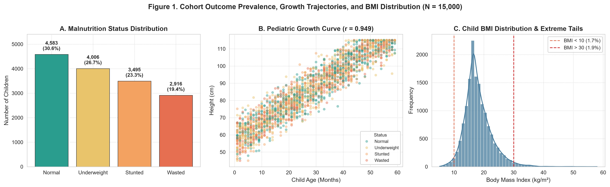
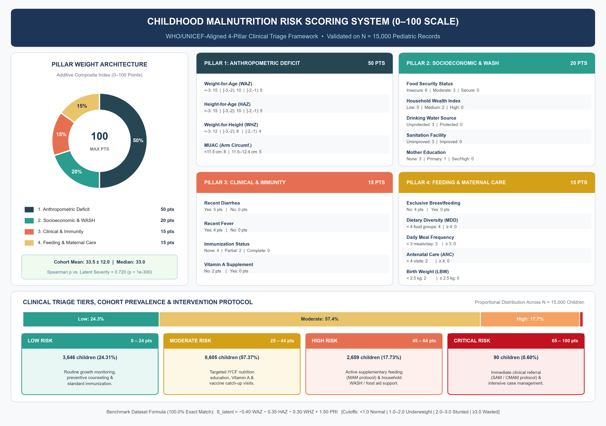

# Childhood Malnutrition Health Analysis & Clinical Risk Scoring


## Overview

**ChildhoodMalnutritionHealth** is a data science and clinical analytics project focused on investigating childhood malnutrition ($n = 15,000$). The project covers exploratory data analysis (EDA), statistical driver identification, latent score modeling, and the development of an interpretable clinical risk scoring system to support early screening and intervention.

---

## Project Structure

```text
ChildhoodMalnutritionHealth/
├── data/
│   └── Childhood_Malnutrition_Dataset.csv      # Raw dataset
├── notebooks/
│   ├── Childhood_Malnutrition_Publication.ipynb # Main analysis & modeling notebook
│   ├── Childhood_Malnutrition_Scored.csv        # Output dataset with risk scores
│   ├── Fig1_EDA_Overview.png                    # Exploratory data analysis overview
│   ├── Fig2_Correlation_Matrix.png              # Feature correlation heatmap
│   ├── Fig3_Statistical_Drivers.png             # Key statistical drivers of malnutrition
│   ├── Fig4_Latent_Score_and_CM.png             # Latent score distribution & confusion matrix
│   ├── Fig5_Clinical_Risk_Scoring.png           # Clinical risk scoring evaluation
│   └── Fig6_Scoring_System_Infographic.png      # Summary infographic of the scoring system
├── .gitignore
├── .python-version                              # Python version specification (3.13.14)
├── pyproject.toml                               # Project metadata and dependencies
├── uv.lock                                      # Locked dependency tree
└── README.md
```

*(Note: Please verify the exact filenames for any truncated entries such as the dataset, notebook, and infographic files.)*

---

## Methodology & Workflow

1. **Exploratory Data Analysis (EDA):** Inspect distributions of malnutrition statuses, demographic indicators, and anthropometric/health variables.
2. **Correlation & Statistical Drivers:** Quantify relationships among features and identify the primary statistical predictors associated with childhood malnutrition.
3. **Modeling & Latent Risk Scoring:** Construct a latent risk score and evaluate classification performance via confusion matrix analysis.
4. **Clinical Risk Scoring System:** Translate statistical findings into a practical, interpretable clinical scoring system and visual infographic for healthcare practitioners.

---

## Key Visualizations

The primary analytical outputs are stored in the `notebooks/` directory:

| Figure | File | Description |
| :--- | :--- | :--- |
| **Figure 1** | `notebooks/Fig1_EDA_Overview.png` | High-level overview of the dataset and malnutrition status distributions. |
| **Figure 2** | `notebooks/Fig2_Correlation_Matrix.png` | Correlation matrix highlighting relationships between key clinical and socioeconomic variables. |
| **Figure 3** | `notebooks/Fig3_Statistical_Drivers.png` | Visualization of the most influential statistical drivers of malnutrition. |
| **Figure 4** | `notebooks/Fig4_Latent_Score_and_CM.png` | Latent risk score distributions alongside model confusion matrix results. |
| **Figure 5** | `notebooks/Fig5_Clinical_Risk_Scoring.png` | Breakdown and validation of the proposed clinical risk scoring thresholds. |
| **Figure 6** | `notebooks/Fig6_Scoring_System_Infographic.png` | End-to-end visual summary of the clinical scoring system. |

### Preview




---

## Getting Started

This project uses **[uv](https://docs.astral.sh/uv/)** for fast, reproducible Python environment and dependency management.

### Prerequisites

- Python `3.13` (managed automatically via `.python-version`)
- `uv` installed on your system:
  ```bash
  # macOS / Linux
  curl -LsSf https://astral.sh/uv/install.sh | sh

  # Windows (PowerShell)
  powershell -ExecutionPolicy ByPass -c "irm https://astral.sh/uv/install.ps1 | iex"
  ```

### Installation

1. **Clone the repository:**
   ```bash
   git clone https://github.com/<your-username>/ChildhoodMalnutritionHealth.git
   cd ChildhoodMalnutritionHealth
   ```

2. **Sync the virtual environment and dependencies:**
   ```bash
   uv sync
   ```

3. **Launch Jupyter Notebook / Lab:**
   ```bash
   uv run jupyter lab
   ```
   Open `notebooks/Childhood_Malnutrition_Publication.ipynb` to explore or reproduce the full analysis.

---

## Results Summary

> **Tip:** Replace the placeholders below with your final model metrics and key clinical findings.

- **Dataset Size:** $n = 15,000$ records
- **Top Statistical Drivers:** *[Add top 3–5 predictors here]*
- **Model Performance:** *[Add AUC-ROC, Accuracy, Sensitivity, or Specificity here]*
- **Risk Tiers:** *[Add Low / Moderate / High risk score cutoffs here]*

---

## License

This project is licensed under the MIT License — see the `LICENSE` file for details (or update with your preferred license).